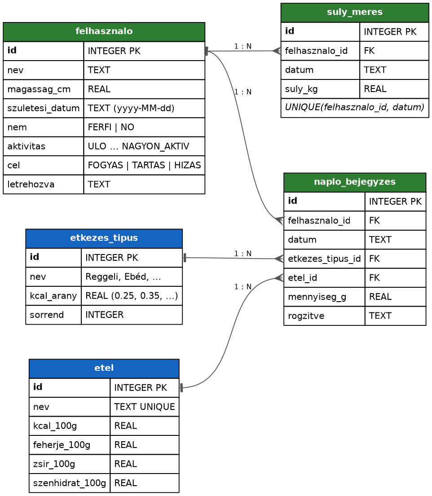

# Kalóriaszámláló (JavaFX + SQLite)

Felhasználónként naplózza a reggelit, ebédet, vacsorát és nasit. A testadatokból
(magasság, testsúly, kor, nem, aktivitás, cél) kiszámolja a napi kalóriakeretet, és
szétosztja az étkezések között. Ha frissül a testsúly, a keret is újraszámolódik.

## Futtatás

```
mvn javafx:run
```

Az adatbázis (`kaloria.db`) az első indításkor jön létre a munkakönyvtárban. A táblákat az
[ORMLite](https://ormlite.com/) hozza létre az annotált model osztályokból (`@DatabaseTable`, `@DatabaseField`).

## Adatbázis terv



Forrás: `docs/adatbazis.dot` (újragenerálás: `dot -Tpng docs/adatbazis.dot -o docs/adatbazis.png`)

| Tábla | Mire való |
|---|---|
| `felhasznalo` | név, magasság, születési dátum, nem, aktivitás, cél |
| `suly_meres` | testsúly történet – az aktuális súly a legutolsó mérés |
| `etel` | ételek, tápérték 100 g-ra |
| `etkezes_tipus` | Reggeli / Ebéd / Vacsora / Nasi + a napi keret hányada |
| `naplo_bejegyzes` | ki, mikor, melyik étkezésnél, mit, hány grammot evett |

## Lépések

- [x] 1. Projekt alap, adatbázis kapcsolat, felhasználó felvétele és listázása
- [ ] 2. Ételek tábla alapételekkel, ételek listázása és felvétele
- [ ] 3. Étkezésnapló (reggeli, ebéd, vacsora, nasi)
- [ ] 4. Napi kalóriakeret számítása és szétosztása az étkezésekre
- [ ] 5. Testsúly frissítése, a keret újraszámolása
